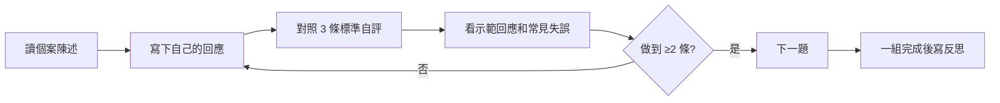
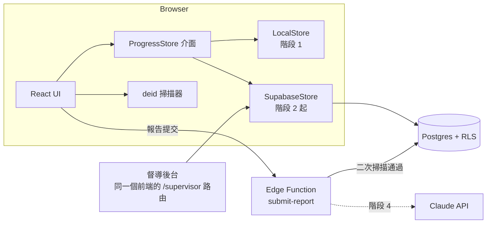
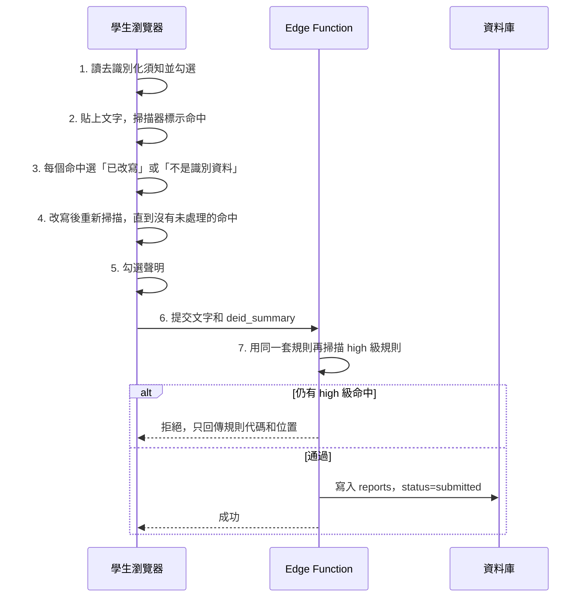

# ClinicMind Practice：刻意練習訓練系統設計規格

日期：2026-11-15　狀態：設計定稿；第 14 節已按用戶回覆更新，餘下一項待確認
路線圖：`docs/roadmap/2026-11-15-master-roadmap.md`

## 1. 目的

讓臨床心理碩士生做三件事：
1. 跟著一個虛構個案，走完由初談到結案的完整療程（走讀）。
2. 用刻意練習逐項掌握回應技巧（練習）。
3. 把實習的學習報告去識別化後上傳，取得按規準的回饋（報告）。

系統是訓練工具。它不給真實個案使用，也不取代督導。

## 2. 使用者與角色

| 角色 | 人數（首批） | 能做什麼 |
|---|---|---|
| student | 10–30 | 走讀、練習、反思、上傳報告、看自己的回饋 |
| supervisor | 1（用戶本人），架構容許多位 | 建班、發邀請碼、看本班學生進度和作答、寫回饋、覆核 AI 草稿、刪除報告 |

沒有公開註冊。學生用邀請碼加入一個 cohort。登入可用任何電郵，不限學校電郵。

## 3. 學習模型

### 3.1 刻意練習循環



硬性規則：
- 學生提交回應之前，介面不顯示示範回應。這條規則由資料層保證：示範回應和題目分開載入。
- 每次嘗試都保存，不覆蓋。進步要看得見。
- 自評是弱證據。督導後台會抽樣顯示「自評全中但回應很短」的作答，供人手覆核。

### 3.2 過關規則

- 題目「達標」：該題最新一次嘗試勾選 ≥2 條標準，且回應 ≥20 個字元。
- 一級「過關」：該模組該級 10 題中 ≥8 題達標。
- 解鎖：easy 預設開放；medium 在 easy 過關後開放；hard 在 medium 過關後開放。
- 模組解鎖：模組 N+1 的走讀，在模組 N 的走讀完成後開放。練習的級別解鎖只看同一模組。
- 督導可為個別學生手動解鎖。

### 3.3 完整療程走讀

- 全系統只有一個貫穿個案：**Client M**（虛構）。用戶指定的設定：25 歲亞裔女性，澳門土生土長，自初中起有抑鬱病史。完整設定見 practice repo 的 `content/CLIENT_M.md`。8 個模組就是 Client M 療程的 8 個階段。這樣學生看到的是一個連續的治療，而不是 8 段無關的片段。
- 每個模組的走讀由 1–2 次「會談」組成。每次會談是一串對話輪次（turn），中間有決策點。
- 決策點有兩種：
  - `choice`：3 個選項。每個選項標記 `fit`：`strong`、`workable`、`weak`，並附一段說明。不用「對／錯」，因為臨床回應很少只有一個正解。
  - `free`：學生自己寫回應，提交後看到治療師實際說的話和理由。
- 每次會談結束顯示「會談筆記」：這次會談的目標、聯盟狀態、概念化的更新。學生因此看到概念化怎樣隨療程演變。

## 4. 課綱（基礎階段）

| # | slug | 療程階段 | 練習的微技能 | 走讀重點 |
|---|---|---|---|---|
| 1 | `intake` | 初談與治療架構 | open-question、restatement | 知情同意、保密限制、設定架構 |
| 2 | `alliance` | 建立聯盟 | reflection-of-feeling、validation | 目標、任務、情感連結三要素 |
| 3 | `assessment` | 評估 | focusing、summary | 由故事到資料；功能性提問 |
| 4 | `formulation` | 個案概念化 | interpretation、challenge | 和個案共同建構 5P |
| 5 | `planning` | 治療計畫 | collaboration-on-goals、rationale-giving | 把概念化轉成可檢查的目標 |
| 6 | `intervention` | 介入 | information-giving、process-direction | 介入時維持聯盟 |
| 7 | `rupture` | 關係破裂與修復 | immediacy、metacommunication | 辨認退縮型和對抗型破裂；修復步驟 |
| 8 | `termination` | 結案 | review、processing-ending | 回顧、鞏固、處理分離 |

- 技能代碼共 16 個，每個模組 2 個。每個模組 30 題（每級 10 題），每個技能每級 5 題。全階段 240 題。
- 難度定義沿用工具包規格：easy＝情緒明確、對治療師友善；medium＝情緒混合或迴避；hard＝對治療師有敵意、質疑或退縮。
- 練習題的個案陳述來自多位不同的虛構個案，不限於 Client M。這樣技能可以遷移。
- 之後的階段：`eft`、`dbt` 各自是一個 stage，結構相同（模組 → 走讀＋練習＋反思）。見第 12 節。

## 5. 內容格式

內容是 repo 內的檔案。建置時用 zod 驗證，驗證失敗則建置失敗。

```
content/
  en/
    stages/foundations/stage.yaml            # 階段標題、模組次序
    stages/foundations/<slug>/module.yaml    # 模組標題、簡介、技能、反思題
    stages/foundations/<slug>/walkthrough.yaml
    stages/foundations/<slug>/drills.yaml    # 只有題目
    stages/foundations/<slug>/models.yaml    # 只有示範回應，鍵為題目 id
  zh-Hant/…                                  # 結構相同，之後才寫
  REVIEW.md                                  # 與工具包相同的審核機制
```

```yaml
# drills.yaml 的一題
- id: intake-e01              # <slug>-<e|m|h><兩位數>
  level: easy
  skill: open-question
  context: "First session. The client has just sat down."
  client: "I'm not sure where to start."
  criteria: ["…", "…", "…"]   # 恰好 3 條

# models.yaml
intake-e01:
  model_response: "…"
  why: "…"                    # 一至兩句，說明示範回應為什麼符合標準
  avoid: "…"

# walkthrough.yaml
sessions:
  - id: intake-s1
    title: "Session 1"
    turns:
      - { id: t1, speaker: therapist, text: "…" }
      - { id: t2, speaker: client, text: "…" }
      - id: d1
        type: choice             # choice | free
        prompt: "What would you say next?"
        options:                 # 只有 choice 有；恰好 3 個；至少一個 strong
          - { id: a, text: "…", fit: strong, note: "…" }
          - { id: b, text: "…", fit: workable, note: "…" }
          - { id: c, text: "…", fit: weak, note: "…" }
        actual: "…"              # 治療師實際說的話
        rationale: "…"
    notes: { goals: "…", alliance: "…", formulation_update: "…" }
```

驗證規則（除了型別）：id 全域唯一；`drills.yaml` 每級恰好 10 題、每個技能每級 5 題；`models.yaml` 的鍵與 `drills.yaml` 的 id 一一對應；每個 choice 決策點恰好 3 個選項且至少一個 `strong`；每次會談至少 1 個決策點。

內容規則與工具包規格 §4 相同：原創、虛構、不放有版權量表、上線前由用戶審核。未審核的模組只在督導帳號可見，學生看不到。

## 6. 架構



- 前端：Vite、React 18、TypeScript（strict）、react-router、zod。樣式用純 CSS 變數，不引入 UI 框架。
- 測試：vitest（單元）、Playwright（端到端）。
- 後端：Supabase（Auth、Postgres、Edge Functions）。區域選新加坡。
- 部署：Cloudflare Pages（靜態）。
- 內容在建置時打包成 JSON。示範回應（`models.yaml`）打包成獨立的檔案，按模組懶載入，並且只在該題已有提交後才請求。

### 6.1 ProgressStore（階段 1 到階段 2 不用重寫的關鍵）

```ts
interface ProgressStore {
  saveAttempt(a: NewAttempt): Promise<Attempt>;
  listAttempts(itemId?: string): Promise<Attempt[]>;
  saveDecision(d: NewDecision): Promise<Decision>;
  listDecisions(sessionId?: string): Promise<Decision[]>;
  saveReflection(r: NewReflection): Promise<Reflection>;
  listReflections(moduleSlug?: string): Promise<Reflection[]>;
}
type NewAttempt   = { itemId: string; response: string; criteriaMet: boolean[] };   // 長度 3
type Attempt      = NewAttempt & { id: string; createdAt: string };
type NewDecision  = { sessionId: string; decisionId: string; optionId?: string; response?: string };
type Decision     = NewDecision & { id: string; createdAt: string };
type NewReflection = { moduleSlug: string; promptId: string; text: string };
type Reflection   = NewReflection & { id: string; createdAt: string };
```

過關與解鎖是純函式，輸入是 attempts 和內容，不依賴儲存方式：
`itemMet(attempts, itemId): boolean`、`levelPassed(attempts, drills, level): boolean`、`unlockedLevels(attempts, drills): Level[]`。

階段 2 登入後，把 LocalStore 的資料一次過匯入 SupabaseStore，然後清除本機資料。

## 7. 資料模型（階段 2 起）

| 表 | 主要欄位 | 說明 |
|---|---|---|
| `cohorts` | id、name、supervisor_id、invite_code（唯一）、term_end（date） | 一班 |
| `profiles` | id（=auth.users.id）、role（student\|supervisor）、display_name、cohort_id | 學生顯示名稱由學生自訂，可用化名 |
| `attempts` | id、user_id、item_id、response、criteria_met（bool[3]）、created_at | 只可新增，不可改 |
| `decisions` | id、user_id、session_id、decision_id、option_id、response、created_at | 只可新增 |
| `reflections` | id、user_id、module_slug、prompt_id、text、created_at | 只可新增 |
| `unlocks` | user_id、module_slug、level、granted_by | 督導手動解鎖 |
| `reports` | id、user_id、title、drive_file_id、deid_summary（jsonb）、status、created_at、delete_after | 正文存在用戶的 Google Drive，見 §8.5 |
| `feedback` | id、report_id、author_id（null＝AI）、scores（jsonb）、comments、status（draft\|released）、created_at、released_at | 學生只看到 released |
| `audit_log` | id、actor_id、action、target_table、target_id、created_at | 不存正文 |

Row Level Security（每張表都開）：
- student：只能讀寫 `user_id = auth.uid()` 的列。`feedback` 只能讀自己報告且 `status = 'released'` 的列。
- supervisor：能讀 `cohort_id` 屬於自己的學生的列；能寫 `feedback`、`unlocks`；能刪 `reports`。
- 沒有任何 policy 容許跨 cohort 讀取。
- `attempts`、`decisions`、`reflections` 沒有 update 和 delete policy。

## 8. 報告上傳與去識別化

### 8.1 原則

1. 只接受貼上的純文字。v1 不接受檔案上傳，因為 DOCX 和 PDF 的中繼資料常含作者姓名和機構。
2. 掃描在瀏覽器內完成。未通過前，文字不離開學生的裝置。
3. 自動掃描會漏。所以還有學生逐項確認、伺服器二次掃描、督導刪除、保存期限四道防線。介面要明白告訴學生：工具會漏，責任在你。
4. 伺服器和日誌永不記錄被拒絕的報告正文。

### 8.2 流程



### 8.3 偵測規則

掃描器是純函式：`scan(text: string): Finding[]`，`Finding = { rule: string; level: 'high'|'medium'|'low'; start: number; end: number; match: string }`。前端和 Edge Function 共用同一份程式碼（`packages/deid/`）。

| rule | level | 偵測內容 |
|---|---|---|
| `hkid` | high | 香港身分證：1–2 個字母＋6 位數字＋括號或無括號的檢查碼；驗證檢查碼以減少誤報 |
| `mo-bir` | high | 澳門居民身分證：首位 1、5、7、8，共 7 位數字＋括號內 1 位 |
| `phone` | high | 香港 8 位（2、3、5、6、7、9 開頭）和澳門 8 位（6、28 開頭），可帶 +852、+853、空格、連字號 |
| `email` | high | 電郵地址 |
| `url` | high | http(s) 連結和 `www.` 開頭的網址 |
| `full-date` | medium | 含年月日的日期：`12/03/2026`、`2026-03-12`、`12 March 2026`、`2026年3月12日` |
| `dob` | medium | 「出生」「DOB」「born」「生於」附近的任何日期或年份 |
| `age-90` | medium | 90 歲或以上的確切年齡 |
| `address` | medium | 地址關鍵字：Road、Street、Estate、Flat、Block、Floor、邨、苑、大廈、街、道＋號、樓、室、座 |
| `institution` | medium | 機構名單（港澳醫院、大學、主要社福機構）和通用字尾：Hospital、Clinic、College、School、醫院、診所、中學、小學、大學、中心 |
| `title-name` | medium | 稱謂＋姓名：Mr、Ms、Mrs、Miss、Dr、Prof 後接大寫詞；常見中文姓氏後接「先生、小姐、太太、女士、醫生、姑娘、老師、sir」 |
| `cjk-name` | low | 常見中文姓氏（前 150 個）後接 1–2 個漢字，且不在停用詞表內 |
| `cap-name` | low | 非句首的連續 2–3 個大寫開頭英文詞，且不在詞表內 |
| `id-like` | low | 6 位或以上的連續數字、病歷號樣式（字母＋5 位以上數字） |

- high：學生必須改寫。不提供「不是識別資料」的選項。伺服器再查一次，仍有就拒收。
- medium、low：學生必須逐項處理（改寫，或標記不是識別資料）。
- `deid_summary` 只存每個 rule 的命中數和處理方式的計數，不存命中的文字。
- 建議的改寫：姓名 → 個案代號；日期 → 「第 3 週」；機構 → 「一間公立醫院」；年齡 → 年齡段。介面在每個命中旁顯示對應建議。

### 8.4 保存

- `delete_after` ＝ cohort 的 `term_end` ＋ 90 天。每日排程刪除過期報告和其回饋。
- 督導可隨時刪除任何一份本班報告。學生可刪除自己的報告。
- 刪除是真刪除。`audit_log` 只留一筆「誰在何時刪了哪個 id」。

### 8.5 報告正文存放在用戶的 Google Drive

用戶要求報告資料存放在自己的 Google Drive。設計如下：

- `reports` 表不存正文。把 `body` 欄改為 `drive_file_id`。資料庫只存標題、`deid_summary`、狀態、日期。
- `submit-report` 通過二次掃描後，把正文寫成一個純文字檔，放進用戶 Drive 內的專用資料夾（每個 cohort 一個子資料夾）。寫入 Drive 成功後才寫資料庫。任何一步失敗，兩邊都不留資料。
- 檔名只用報告 id，不含學生姓名或標題。
- 讀取：學生和督導經 Edge Function `get-report` 讀正文。函式先用 RLS 規則核對權限，再向 Drive 取檔。前端不直接接觸 Drive。
- 刪除和保存期限：刪除報告時同時刪除 Drive 檔案。排程清理也一樣。
- 授權方式：首選用戶本人帳號的 OAuth 授權，範圍限 `drive.file`（只能存取本系統建立的檔案），檔案擁有者是用戶。refresh token 存在 Edge Function 的密鑰設定，不進 repo。動工時先做冒煙測試確認可行；服務帳號方式可能受儲存配額限制，列為後備。
- 新增的失敗情況要有測試：Drive 授權過期、Drive 寫入成功但資料庫寫入失敗（要回滾刪檔）、Drive 檔案被用戶手動刪除（顯示「檔案已不存在」，不可崩潰）。
- 提醒：個人 Google 帳號不是為敏感資料設計的。這個做法成立的前提，是報告已去識別化。

### 8.6 開放條件

報告功能有獨立開關 `reports_enabled`（每個 cohort 一個，預設關）。用戶確認實習單位政策後，才為該 cohort 打開。

## 9. 回饋規準（報告）

六個向度，每個向度四級：1 Emerging、2 Developing、3 Proficient、4 Advanced。

| 代碼 | 向度 | Proficient（3）的描述 |
|---|---|---|
| `picture` | 個案圖像清晰 | 主訴、背景、現況描述具體，讀者能想像這位個案 |
| `formulation` | 概念化連貫 | 各因素之間有明確的因果連結，寫成假設 |
| `link` | 概念化與介入的連結 | 每項介入都能追溯到概念化的某一部分 |
| `process` | 歷程與聯盟觀察 | 描述會談中的互動和聯盟變化，不只是內容 |
| `self` | 自我反思 | 指出自己的反應、盲點或限制，並連結到下一步 |
| `ethics` | 倫理與保密 | 沒有識別資料；提到同意、限制或督導的使用 |

- 四級的完整描述寫在 `content/en/rubrics/report.yaml`，由用戶審核。
- 階段 3：督導人手填分數和評語，按「發布」後學生才看到。
- 階段 4：AI 產生草稿（`author_id = null`、`status = 'draft'`）。學生看不到草稿。督導修改後發布。AI 草稿在學生端永遠標示「經督導覆核」。

## 10. AI 回饋（階段 4，需用戶批准預算後才做）

- 只在 Edge Function 呼叫。API 金鑰不進前端。
- 模型：練習回饋用 `claude-haiku-5-5`；報告回饋用 `claude-sonnet-5-5`。
- 送出的資料：文字正文、規準、題目。不送姓名、電郵、user id、cohort 名稱。
- 輸出用結構化 JSON（每個向度的分數、一段證據引文、一項具體建議），由 zod 驗證。驗證失敗就不儲存。
- 提示規則：只按規準評；引用學生原文作證據；不作診斷；不給個案處置指示；遇到風險內容只回「請立即聯絡督導」。
- 用量上限：每名學生每日練習回饋 30 次、每週報告回饋 2 次。超過就顯示上限訊息。
- 總開關：`ai_enabled`（每個 cohort 一個）。關閉時系統功能與階段 3 完全相同。
- 動工前要做的事：按當時定價估算每名學生每月成本，交用戶批准；確認 API 供應商的資料保存條款。

## 11. 介面

路由：`/`（階段總覽）、`/m/:slug`（模組首頁：走讀、練習、反思三個入口和進度）、`/m/:slug/walkthrough/:sessionId`、`/m/:slug/drills/:level`、`/m/:slug/reflect`、`/reports`、`/reports/new`、`/reports/:id`、`/supervisor`、`/supervisor/students/:id`、`/supervisor/reports/:id`、`/join`、`/login`。

- 語言：UI 字串集中在 `src/i18n/en.ts`，預留 `zh-Hant.ts`。v1 只有英文。
- 無障礙：全鍵盤可操作；對比度達 WCAG AA；表單欄位都有 label。
- 每頁頁尾固定一行：`Training tool. Not for use with clients in crisis. If someone is at risk, follow your placement's policy and contact your supervisor.`
- 手機可用（學生會在通勤時練習）：最窄支援 360px。

## 12. 之後的階段：EFT 與 DBT

- 結構沿用：stage → modules → 走讀＋練習＋反思。內容格式不變，只多一個 `stages/<stage>/`。
- 每個新階段各有自己的貫穿個案。
- DBT 階段的模組草案：生物社會理論與認可、承諾策略、行為鏈分析、技能教導（正念、痛苦耐受、情緒調節、人際效能）、辯證策略、治療干擾行為的處理。
- EFT 指 Greenberg 的 Emotion-Focused Therapy（個人治療）。模組草案：同理調頻與情緒探索、情緒類型的辨認（原發適應、原發不適應、次級、工具性）、標記與任務（對不清晰感受做聚焦、對自我批評分裂做雙椅、對未完成事件做空椅、對困惑反應做系統性喚起展開）、情緒轉化、EFT 的個案概念化。
- 這兩個階段的技能清單和內容，動工前要另寫規格並由用戶審核。內容必須原創；不複製已出版的刻意練習書的題目。

## 13. 階段與驗收標準

| 階段 | 驗收標準 |
|---|---|
| 1 | 學生不用登入，能完成 `intake` 和 `alliance` 兩個模組的走讀、三級練習和反思；過關和解鎖規則正確；重新整理後進度仍在；提交前拿不到示範回應 |
| 2 | 邀請碼加入、登入、進度跨裝置同步；8 個模組齊備；督導看到本班進度和作答；學生 A 讀不到學生 B 的任何資料（自動化測試證明） |
| 3 | 去識別化測試集全過；含 high 級識別資料的文字在前端和伺服器都被擋；督導能評分、發布、刪除；過期報告被排程刪除 |
| 4 | AI 草稿不對學生顯示；用量上限生效；關閉 `ai_enabled` 後功能與階段 3 相同 |

## 14. 已回答的問題（用戶 2026-11-15 回覆）

1. EFT 指 Greenberg 的 Emotion-Focused Therapy。→ 已寫入 §12。
2. 實習單位容許把去識別化的報告上傳到校外系統。資料最好存在用戶的 Google Drive。→ 已寫入 §8.5。
3. 報告保存期限：學期結束後 90 天。確認。
4. Client M：25 歲亞裔女性，澳門土生土長，自初中起有抑鬱病史。→ 已寫入 §3.3。
5. 登入：任何電郵都可以。→ 已寫入 §2。

### 仍待確認

- Client M 的療程走讀是否包含風險評估的示範（見 `content/CLIENT_M.md` 的「需你決定」）。
- §8.5 的 Drive 方案是「正文只存 Drive」。另一個較簡單的做法是「正文存資料庫，每日備份到 Drive」。前者較符合你的要求，但多了 Drive 授權過期等失敗情況。預設採用前者，除非你另有指示。

## 15. 不做的事

- 不做即時 AI 模擬個案對話（日後可作為獨立階段評估）。
- 不做檔案上傳、語音、錄影。
- 不做學生之間的互評和討論區。
- 不做收費（階段 4 之後再評估）。
- 不做原生 App。
